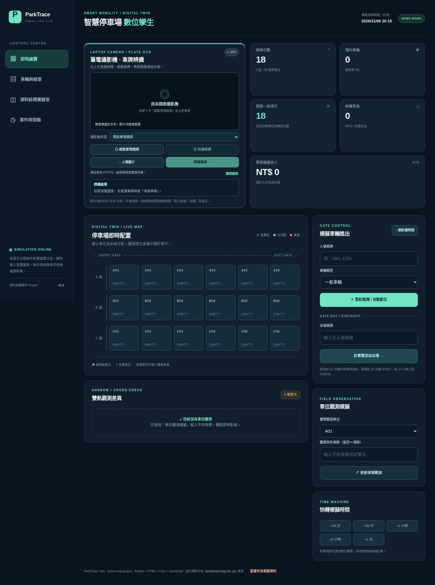
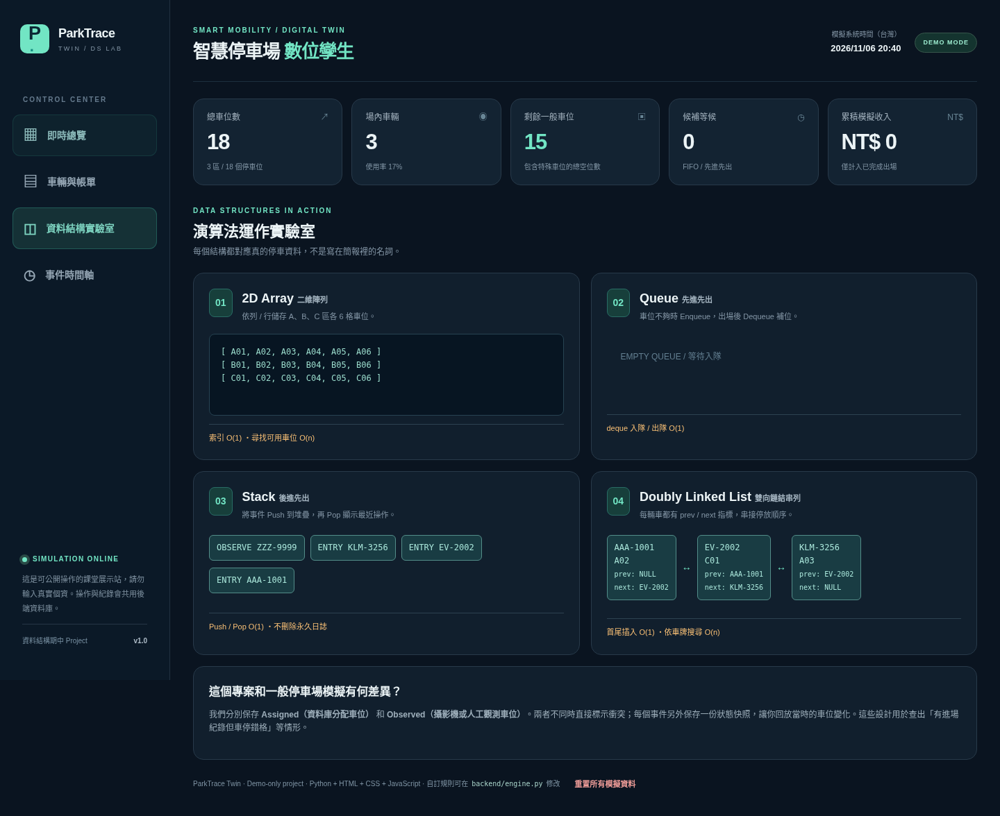

# ParkTrace Twin — 智慧停車場 × 資料結構數位孿生

> 資料結構期中 Project：以 **Python + HTML + CSS + JavaScript** 建立可在 VS Code 編輯、可由 GitHub 佈署到 Render 的停車場。除使用實體攝影機拍照外，其餘流程都能從網頁模擬。

## 畫面預覽





## 特色：雙軌車位數位孿生

傳統作品通常只做「空位 → 分配 → 出場 → 收費」。本作品還有一層 **現場觀測值 (Observed)**：

- **Assigned**：系統依車輛類型與距離挑選的車位，來自停車紀錄。
- **Observed**：現場攝影機、管理員或模擬器回報該車位看到的車牌。
- **Cross-check**：如果觀測車牌與分配車牌不同，車位會紅色顯示並產生警示。
- **Event snapshot replay**：每次操作都保存一份當下「車位陣列 + 候補佇列 + 觀測資料」快照。按事件可回到歷史畫面，但**不修改現況**。

車牌辨識使用網站**左上方的筆電攝影機面板**（開啟鏡頭 → 拍照 → 拖曳框選車牌 → OCR）。後端以 Tesseract 搭配多組影像前處理產生候選，依辨識一致次數排序。OCR 只產生「候選車牌」，必須由人確認後才寫入正式進出場紀錄；不能當成無人值守商業辨識系統。

## 功能

| 網頁操作 | 實際行為 | 後端儲存 |
|---|---|---|
| 登記入場 | 校正車牌，判斷重複車牌，依車型選擇最合適車位 | visits、events |
| 滿位候補 | 一般車位滿後排隊，出場時自動 FIFO 補位 | wait_items、visits |
| 出場計費 | 真正從後端時間計費，保存每筆完成帳單 | visits、events |
| 車位觀測 | 記錄現場看到哪台車；不同則亮紅燈 | observations、events |
| 快轉時間 | 不需要真的等 1 小時，網頁可快轉 15 分鐘至 1 天 | settings、events |
| 事件回放 | 重播每次事件後的二維車位狀態 | events.snapshot_json |
| 左上方相機 / 上傳圖片 | 可選筆電內建鏡頭、預覽、拍照及拖曳框選牌照；Python OCR 多種影像處理、候選排序、人工確認後帶入進出場 | **原始照片不保存** |
| 資料結構實驗室 | 直接視覺化四種資料結構的目前內容 | 每次讀取資料庫重建 |

## 使用了哪些資料結構？

| 資料結構 | 程式位置 | 用途 | 典型時間複雜度 |
|---|---|---|---|
| **2D Array** | `backend/structures.py` → `parking_grid()` | A/B/C 三排、每排 6 格的車位狀態 | 座標存取 O(1)；找車位 O(n) |
| **Queue** (`deque`) | `backend/structures.py` → `fifo_queue()`；`engine.py` → `_promote()` | 滿位排隊與先進先出；隊列由資料庫 id 保留次序 | deque enqueue/dequeue O(1)，DB 查詢另計 |
| **Stack** (`list`) | `backend/structures.py` → `lifo_stack()` | 由舊到新 Push 近期事件，再逐筆 Pop 當作倒序操作紀錄 | Push/Pop O(1) |
| **Doubly Linked List** | `backend/structures.py` → `ActiveDoublyLinkedList` | 場內車輛依入場順序連結，視覺化 prev/next 指標 | 尾插入 O(1)，搜尋 O(n) |

對應你上傳的課程教材：第二章陣列、第三章堆疊、第四章佇列、第五章鏈結串列，以及第一章的時間複雜度。*注意：資料庫有自己的索引與查詢成本；上表列的是資料結構操作的理論複雜度，並非整支 API 的總成本。*

## 目錄結構

```text
ParkTrace-Twin/
├── backend/
│   ├── app.py          # HTTP API + 靜態網頁伺服器
│   ├── engine.py       # 進出場、候補、觀測、計費、時間回放
│   ├── models.py       # SQLite / PostgreSQL 表格
│   ├── structures.py   # 陣列、佇列、堆疊、雙向鏈結串列
│   └── ocr.py          # OCR 圖片解碼與候選車牌
├── web/
│   ├── index.html      # 網頁區塊
│   ├── styles.css      # 配色與排版
│   └── app.js          # 網頁互動 / API 呼叫 / 相機畫面
├── tests/test_engine.py
├── docs/API.md
├── docs/DEMO_GUIDE.md
├── Dockerfile
├── render.yaml
├── requirements.txt
└── .vscode/launch.json
```

## 1. VS Code 本機啟動

建議 Python **3.12**（3.11 也可），安裝 VS Code Python 擴充套件。解壓 ZIP 後，**用 VS Code 開啟整個 `ParkTrace-Twin` 資料夾**，不是只開 `backend/app.py`。

**Windows / PowerShell**

```powershell
cd ParkTrace-Twin
py -3.12 -m venv .venv
.venv\Scripts\Activate.ps1
pip install -r requirements.txt
python -m backend.app
```

如果 Windows 阻止啟動 venv 的 PowerShell 腳本，也可直接改用 `.venv\Scripts\python.exe -m pip install -r requirements.txt`、`.venv\Scripts\python.exe -m backend.app`。

**macOS / Linux**

```bash
cd ParkTrace-Twin
python3 -m venv .venv
source .venv/bin/activate
pip install -r requirements.txt
python -m backend.app
```

瀏覽器前往 **http://localhost:8000**。SQLite 資料會儲存在專案根目錄的 `parking_local.db`；關閉後重新執行資料仍在。若 8000 埠已被占用，可設定 `PORT` 環境變數。VS Code 也提供 F5 偵錯設定 `.vscode/launch.json`。

### 本機使用 OCR

OCR 需要 **Python 的 pytesseract**（已在 requirements）和作業系統的 **Tesseract 執行檔**：

- Windows：安裝 Tesseract OCR，並把安裝目錄（包含 `tesseract.exe`）加入 PATH。
- macOS：`brew install tesseract`。
- Ubuntu / Debian：`sudo apt install tesseract-ocr`。
- Render：`Dockerfile` 已自動安裝 Tesseract，因此不必手動進伺服器安裝。

**筆電鏡頭使用流程**：在頁面左上方選「啟動筆電鏡頭」→ 接受瀏覽器的攝影機使用權限 → 如有多個鏡頭可在「攝影機來源」切換 → 把車牌放大、對焦並保持水平 → 按「拍攝車牌」→ 如有需要在照片中拖曳框選 → 按「辨識車牌」→ 核對候選字串 → 點「帶入進場／帶入出場」，最後由使用者手動送出表單。拍照後會自動關閉攝影機；要重拍請重新啟動。

相機功能在 HTTPS 網站或 `localhost` 運作；一般 HTTP 網址通常無法開啟鏡頭。若無法使用鏡頭，請檢查瀏覽器權限及是否被 Teams／Zoom 佔用；也可改上傳 JPG／PNG／WebP（不超過 3MB）。OCR 的一致次數**不是機率或辨識準確度**，應在明亮、近距離及裁切車牌的條件下使用。若仍辨識不出來，請直接手動輸入車牌。

## 2. 建立 GitHub Repository

**此專案已預先設定 `jerrylintw` 帳號的上傳指令；詳細逐步教學請見 [`docs/DEPLOY_JERRY.md`](docs/DEPLOY_JERRY.md)。** 目前的倉庫網址只是目標路徑，必須在 GitHub 建立空倉庫並 push 後才會生效。

1. 使用 GitHub 帳號 **`jerrylintw`**，右上角 **New repository**，名稱 `parktrace-twin`，選擇 Public（僅供課堂展示）。
2. 在專案的 VS Code 終端機執行以下指令：

```bash
git init
git add .
git commit -m "Initial ParkTrace Twin project"
git branch -M main
git remote add origin https://github.com/jerrylintw/parktrace-twin.git
git push -u origin main
```

GitHub 可能要求登入或使用 Personal Access Token；如果你使用 VS Code 的 Source Control，也能直接「Publish to GitHub」。`.gitignore` 已排除本機 SQLite、虛擬環境、快取及環境檔案。**請勿把密碼、憑證、真實車牌資料上傳到公開 repo。**

## 3. Render 部署（含資料庫）

最簡單的方式是 Render **Blueprint**，因為專案已提供 `render.yaml` 和 `Dockerfile`：

1. 登入 [Render Dashboard](https://dashboard.render.com/)，選擇 **New → Blueprint**。
2. 授權連線上述 GitHub repository，選擇含 `render.yaml` 的 `main` 分支。
3. 檢視資源：一個 Docker Web Service、一個 PostgreSQL Database，預設均設定 `free`，區域 `singapore`。
4. 按 Apply。系統會建立 PostgreSQL，並透過 `DATABASE_URL` 自動接到 Python 後端。
5. 建立成功後開啟該 Web Service 的 `https://...onrender.com` 網址，`/healthz` 若顯示 `{ "ok": true }` 代表服務就緒。

**為何不直接把 SQLite 放在免費 Render？** 免費 Web Service 的本機檔案在重新部署、休眠或重啟時不保證保留，因此使用資料庫服務保存紀錄。**注意 Render Free PostgreSQL 有 30 天使用期限、資料庫無自動備份，這是期中展示方案，不適合實際收費營運。** 免費服務閒置會休眠，首次開啟需要喚醒時間。請以 Render 當下方案條款為準。

若 Render 帳號已經有免費 PostgreSQL（每個 workspace 限一個），可能無法再建立第二個 Free DB。改用既有資料庫的連線字串，在 Web Service 環境變數設定 `DATABASE_URL`，或升級資料庫方案。

## 4. 如何修改題目內容

- **停車費公式**：`backend/engine.py` → `calculate_fee()`；另需同步更新 `state()['rules']` 和網頁說明。
- **車位分配偏好**：`backend/engine.py` → `_choose_spot()`。
- **車位數與區域**：`backend/engine.py` → 初始化 seed；`backend/structures.py` → `parking_grid()`；`web/app.js` → `spotOptions`，需要同步修改，建議先保留 3×6 以便報告。
- **主題顏色**：`web/styles.css` 頂端 `:root` 的 `--teal / --panel / --bg`。
- **文案與標題**：`web/index.html`。
- **車牌格式**：`backend/engine.py` → `PLATE_RE`，OCR 偵測規則也在 `backend/ocr.py`。
- **資料結構實作**：`backend/structures.py`，方便在口頭報告逐行展示。

## 5. 執行測試

```bash
python -m unittest discover -s tests -v
```

主要驗證：費率邊界、重複進場拒絕、專用車位、FIFO 候補、自動補位、觀測衝突、事件快照、資料重啟持久化、鏈結節點刪除，以及 OCR 無連字號車牌與候選排序。

## 6. 安全與專案範圍

- **僅為課堂展示**：目前沒有登入、角色控管或線上刷卡；部署在網路上的任何訪客都可修改、重置同一份模擬資料。**不得直接用於真正的停車場營運或真實金流**。
- **不保存照片**：`/api/ocr` 僅在伺服器記憶體中處理上傳圖片，並返回候選車牌；後端只存經使用者確認的車牌文字和事件紀錄。
- **OCR 可能辨識錯誤**：依光線、相機角度、背景、裁切、髒污等不同，成功率有差異。這份作品沒有訓練客製台灣車牌模型，也沒有進出場硬體柵欄控制。
- **原創設計定位**：雙軌對帳 + 事件狀態回放 + 可視化資料結構的組合是本專案的特色；無法保證全世界不存在構想類似的作品。
- **可進一步發展**：新增管理員登入、CSRF / 速率限制、真正的車位攝影機識別、單據匯出、資料庫 Migration、實際付款閘門及個資保存期限。

## 參考資料

- 課程講義：`001_第一章 資料結構導論.pdf`、`002_第二章 陣列.pdf`、`003_第三章 堆疊.pdf`、`004_第四章 佇列.pdf`、`005_第五章 鏈結串列.pdf`（未將講義本身轉載進專案）。
- Render 官方文件：[Blueprint](https://render.com/docs/infrastructure-as-code)、[Free limitations](https://render.com/docs/free)。
- OCR 引擎：[Tesseract](https://github.com/tesseract-ocr/tesseract)。

---

**Project Scope:** 可操作的單一課堂 demo；系統可靠性及辨識率未經真實場域驗證。
